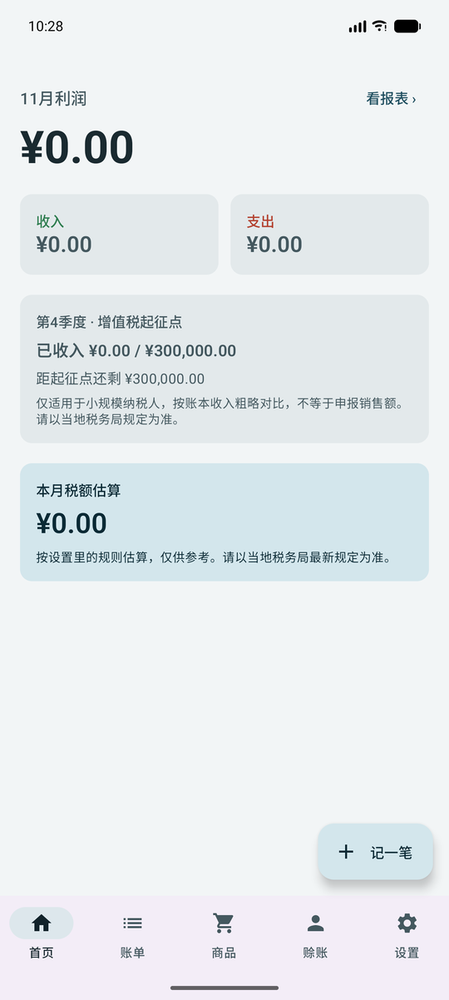
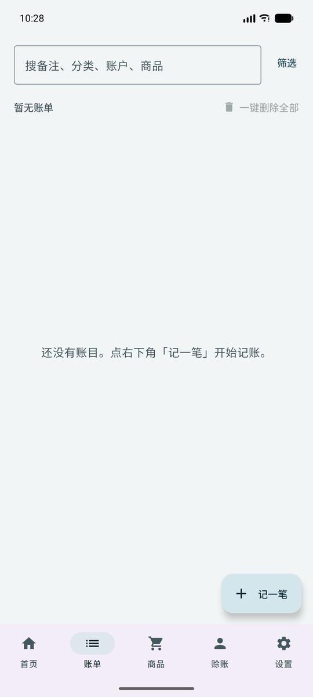
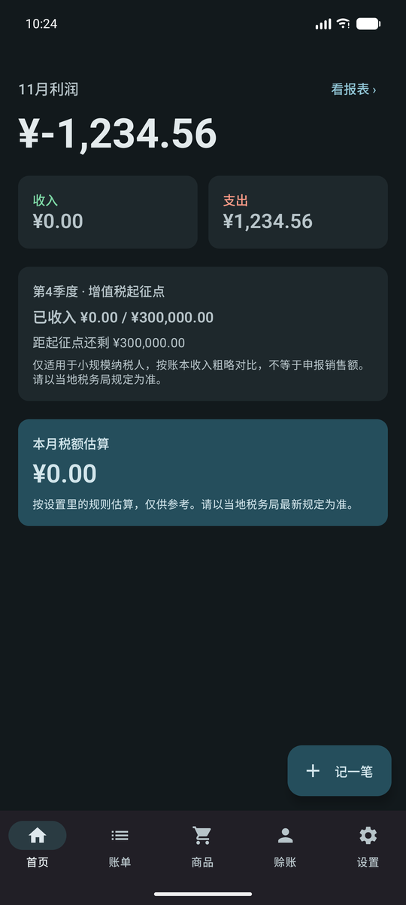

# 小店账本

给县城个体户、小卖部、烟酒店用的记账小工具：记一笔、看利润、估个大概的税、盯住压货和卖得快的货、管赊账、看报表、发报表。
Kotlin + Jetpack Compose + Room，单模块，MVVM，全离线，数据只存在手机上。

当前版本：**0.8.0**（versionCode 11，数据库 v5）

| 首页 | 账单 | 深色模式 |
|---|---|---|
|  |  |  |

## 功能一览

- **记一笔**：收入/支出、金额、分类、账户、日期（可补记/改日期）、商品+数量、单据照片、备注
- **改账**：账单列表点任意一条进入修改；只改日期时，时分沿用原来那一笔
- **账单**：按天分组（头部显示当天收支小计）、搜索（备注/分类/账户/商品，250ms 防抖）、筛选（本月/上月/分类/账户）、一次取 200 条 + 加载更多、一键删除全部、单据点开看大图
- **回收站**：删除先进回收站，30 天内可恢复；超期自动清理
- **首页**：本月利润、收入/支出、季度起征点提醒、本月税额估算（规则可配）、进货提醒卡（畅销/滞销各最多 3 条）、报表入口
- **报表**：按月切换、收入/支出/利润、支出分类占比、收入来源、近 6 个月利润柱状图、**一键分享给会计/家人（文本）**
- **商品**：毛利排行、畅销/滞销标签、库存估算、压货金额、一键清空商品
- **赊账**：客户、每笔赊账、收款/撤销收款、删除客户（连带记录）
  - 记赊账时同时记一笔收入（分类「销售收入」、账户「赊账」），即「赊出去就算卖了」；收款只冲欠款
  - 删赊账/删客户会把对应收入账单放进回收站
- **设置**
  - 分类管理 / 账户管理（有账单用着的分类删不掉，含回收站里的）
  - 税务规则（每月免税额、税率、季度起征点）
  - 回收站、备份与恢复
  - 应用锁：4~6 位数字，冷启动校验，退后台超过 30 秒回来重新锁；连错 5 次锁 30 秒，**计数落盘，杀进程也绕不过**
  - 关于：版本、上次崩溃记录（应用锁只防熟人随手翻，不是系统级加密）
- **备份**
  - CSV：账单 + 赊账，导入可选「跳过重复」或「全部导入」
  - ZIP：CSV + `receipts/` 里的单据照片，换机能带图
  - **加密备份（.yjb）**：AES-256-GCM + PBKDF2 派生，设了备份密码后自动备份也是加密的；换手机输密码即可解密
  - 自动备份每天一次，写到「下载/小店账本」（Android 10+，卸载不丢）

## 怎么跑

1. Android Studio 打开 `XiaodianZhangben` 这一层目录，等 Gradle 同步
2. 手机开「开发者选项 → USB 调试」，数据线连电脑，点运行

命令行：

```powershell
# 测试 + 迁移校验 + debug 包（加 -Release 再打 R8 的 release 包）
powershell -ExecutionPolicy Bypass -File scripts/build-and-test.ps1
```

或直接：

```powershell
./gradlew :app:testDebugUnitTest
python scripts/verify_migrations.py
./gradlew :app:assembleDebug
```

产物：`app/build/outputs/apk/debug/app-debug.apk`

### release 签名

`xiaodian.jks` 和 `keystore.properties` 已在本机生成（都在 `.gitignore` 里，不会进仓库）。
**这两个文件请立刻备份到别处**：以后升级 App 必须用同一个签名，丢了就没法覆盖安装。

```powershell
./gradlew :app:assembleRelease
```

产物 `app/build/outputs/apk/release/app-release.apk`，已用 `apksigner` 验过：
证书 `CN=Xiaodian Zhangben`，SHA-256 `24e57cf398df41748912df981abf39804c6e3ba7d8aad1d958a0cec1f38c9ae3`。

换机器/换密钥时：`keytool -genkeypair -v -keystore xiaodian.jks -alias xiaodian -keyalg RSA -keysize 2048 -validity 10000`，再照 `keystore.properties.example` 填一份。

## 项目结构

```
app/src/main/java/com/example/ledger/
├── data/
│   ├── db/            Room：实体、DAO、数据库（v5，1→2→3→4→5 迁移，schema 导出在 app/schemas）
│   ├── repository/    数据统一入口
│   ├── backup/        CSV / ZIP 备份恢复、自动备份、导入去重
│   └── settings/      SharedPreferences：税务规则、应用锁（SHA-256 加盐 + 失败计数）、自动备份
├── domain/            Money、Period、product、report、backup(CSV)、tax、lock
├── ui/                home / records / add / products / debts / report / settings / lock / common / theme
├── navigation/        底部 5 个 Tab + 记一笔（带编辑 id）+ 报表
└── LedgerApplication.kt / MainActivity.kt
```

## 工程化

- **单元测试** 57 个：Money、ProductAnalyzer、ProductInsight、CsvLedger、BackupCrypto、ReportMath、TaxEstimator、ThresholdMonitor
- **迁移校验**：`scripts/verify_migrations.py` 读 `app/schemas/*.json`（Room 导出），在 SQLite 里跑整条迁移链并比对列定义/索引，不需要手机
- **CI**：`.github/workflows/android.yml` 跑单测 + 迁移校验 + 组包
- **Lint**：`./gradlew :app:lintDebug`，当前只剩一条 `ObsoleteSdkInt` 提示
- **崩溃记录**：未捕获异常写到 `files/crash/last-crash.txt`，设置页可看可清

## 设计约定

- 金额一律用「分」存 Long，只在显示时换成元（`formatCents`）
- 删除是软删除（`deletedAtMillis`），回收站 30 天
- 赊账与收入：赊出即计收入（自动生成收入账单，账户「赊账」），收款只冲欠款
- 税率、免税额、起征点可配置；**界面税额只是估算，不是申报依据**
- 界面 → ViewModel → Repository → DAO 单向依赖；纯逻辑都在 `domain/` 并配单测

## 还没做的（已知）

- 文案未抽到 `strings.xml`（约 290 处中文硬编码）
- `SettingsScreen` / `RecordsScreen` 仍是千行级单文件；`LedgerRepository` 一个类管账单/商品/赊账/报表
- DAO、ViewModel、迁移的 instrumentation 测试（需要真机/模拟器；当前用 schema JSON + SQLite 脚本兜底）
- 依赖停在一代前（AGP 8.7.3 / Kotlin 2.0.21 / Compose BOM 2024.10）
- 云端同步 / 多设备（方案见下）

## 云端 / 多设备 / 发会计（规划）

三件事分开做，别混在一起：

1. **先做「发会计」**：报表页已有文本分享；下一步加导出 PDF/Excel（`Intent` 分享文件）。零后端、零风险。
2. **再做「多设备同步」**：加 `updatedAt`、`deletedAt`、`deviceId`、`rev` 四个字段，走「单写者 + 最后写入为准 + 冲突列出来让用户选」。后端首选一台上云函数 + Postgres（Supabase 最省事），只同步增量。
3. **最后做「云备份」**：把现有 CSV/ZIP 上传到对象存储（按用户 token 分区），只做整本快照，不做实时同步，成本最低、风险最小。

## 改名提示

包名是 `com.yuanguangbb.ledger`。要改：Android Studio 右键包名 → Refactor → Rename，再改 `app/build.gradle.kts` 里的 `namespace` 和 `applicationId`。